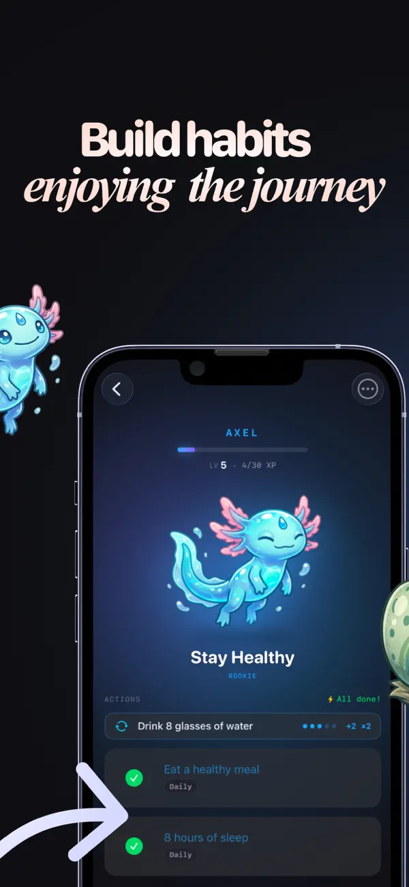
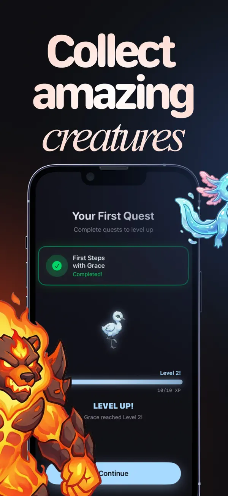
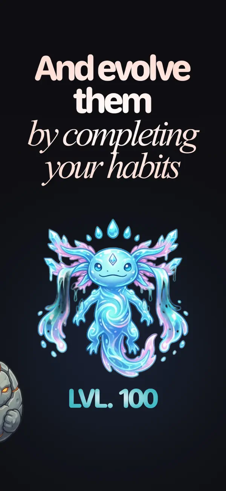
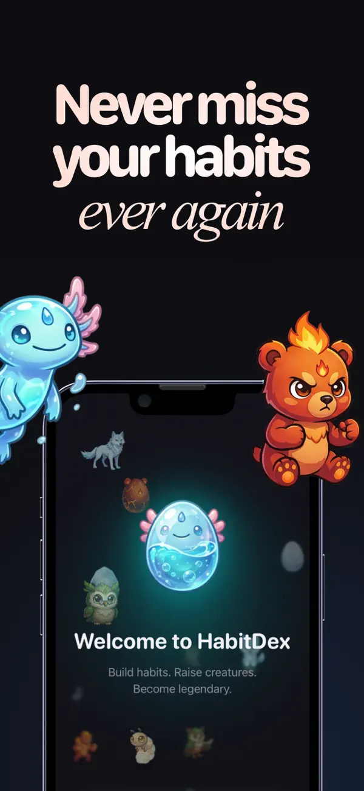

[← Home](../../)

# HabitDex

[Miguel Ferrer](https://www.linkedin.com/in/mffdr/?locale=en) designed HabitDex. I built the iPhone app.

The premise is simple. Checking off a habit gives your companion XP. Consistent days protect a streak, unlock creatures, and evolve the ones you already have. The Pokémon-style loop gives a small routine a visible consequence.

Core habit data stays on the device. CloudKit sync is optional for people who want the same progress on more than one Apple device.

## The daily loop

Log today's habits from the home screen. See streaks and recent progress without opening a separate report. Review each habit over time and adjust the routine when it stops working.

Earn creatures and evolve them through repeated check-ins.

## How it was built

The interface is SwiftUI, built from Miguel's layouts and interaction states. Apple's on-device data model handles persistence. CloudKit handles optional sync, so there is no separate server that stores habit history.

StoreKit and RevenueCat handle HabitDex PRO subscriptions and the paywall. The free tier remains usable without a subscription.

Shipping also meant device testing, privacy labels, App Store feedback, and the less glamorous work of making first-run setup clear on a small screen.

## Links

- [HabitDex on the App Store](https://apps.apple.com/us/app/habitdex/id6755887620)
- [Product site](https://v0-habitdex.vercel.app/)
- [Miguel Ferrer on LinkedIn](https://www.linkedin.com/in/mffdr/?locale=en)
- [Privacy policy](https://v0-habitdex.vercel.app/privacy) · [Terms](https://v0-habitdex.vercel.app/tos)
