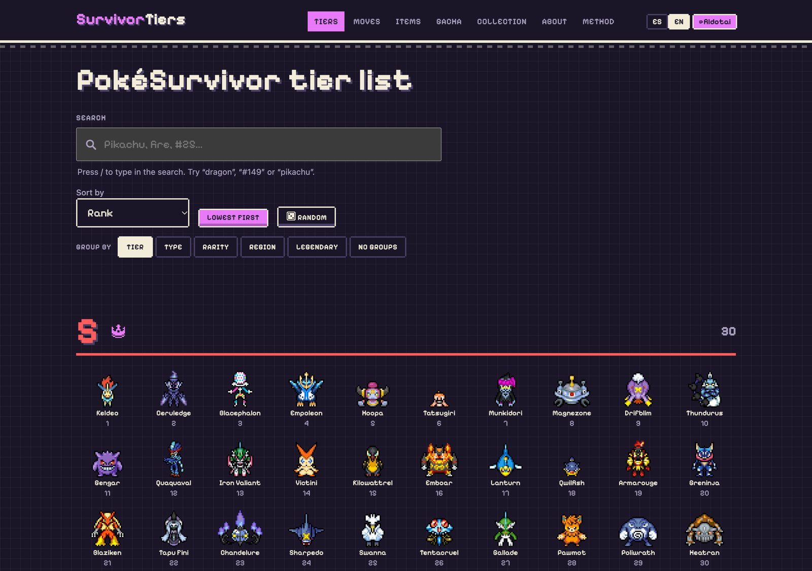

[← Home](../../)

# SurvivorTiers

SurvivorTiers is an unofficial tier list for PokéSurvivor, a free fan-made browser game. It ranks all 966 Pokémon in five tiers, and every rank comes from data: simulated games, a model of each Pokémon's sheet, and a late-game formula, rerun 2,000 times so each rank has a range instead of a single guess.

It is a static site in English and Spanish, with a page per Pokémon, tier lists for moves and items, gacha odds, and a collection tracker. The data is published as CSV and JSON with an `llms.txt`, so AI assistants can answer questions from it.

## How the game works

[PokéSurvivor](https://pokesurvivor.com) is a survivor-style game, in the line of Vampire Survivors and Survivor.io, free to play in the browser. You pick a Pokémon and move it around a map while hordes close in, and its attacks fire on their own. Defeated enemies drop experience, and each level offers cards: new attacks, boosts, and evolutions of attacks you already have. You carry one item per run, found in chests.

Between runs, coins buy shop upgrades that make every later run stronger, and a gacha with nine regional banners unlocks more Pokémon. Runs get harder over time, with bosses and rifts, and up to four friends can play together.

So a Pokémon's value is not just its official stats. It depends on the attack it starts with, the attacks it can learn, how big a target it is, and how it holds up late in a run.

## How the rank is built

Each Pokémon gets three scores, and each becomes a percentile so seconds and stats can be compared:

- **Sheet:** base stats, the attacks it can learn, type resistance, and hitbox size.
- **Simulated games:** a bot plays 200 games with the starting attack and 200 with the best attack it can learn, and the median survival time is the score.
- **Late game:** a formula for the end of a run, once with every shop upgrade maxed and once with none.

They are combined with a geometric mean, so one very weak piece pulls the score down instead of being averaged away.

{{ST_METHOD}}

Tiers have fixed sizes: 30 in S, 90 in A, 200 in B, 300 in C, and 346 in D. A Pokémon also has to clear minimums to enter a tier. S needs the top 40% on stats, attacks of three different types, and a starting attack that is not melee. A Pokémon that misses a minimum waits for the next tier it qualifies for.

## What the simulations show

{{ST_REPLAY}}

The first simulator was written in JavaScript, like the game. To run hundreds of thousands of games, I rewrote it in Rust: about 4,000 lines that run games in parallel across every core. With V8's math functions replayed, it matches the JavaScript engine bit for bit, and every change to the rules is re-checked against it. On a 10-core laptop, 28,980 games take 4.4 seconds in Rust against 28.4 in JavaScript, about 6.5 times faster.

{{ST_SIMS}}

The starting attack is the clearest split in the game. A Pokémon that starts with a projectile survives three times longer than one that starts in melee, because melee means walking into the swarm. Two thirds of tier D start with a melee attack, none of tier S does, and a melee start is one of the minimums that keeps a Pokémon out of S.

## Which stats matter

{{ST_STATS}}

Survival with the best attack follows the final rank most closely, which is why the attacks a Pokémon can learn weigh as much as its stats. Among the official base stats, **Sp. Atk** matters most, then Attack and Speed. Defense matters least: in a game about not being touched, avoiding hits beats absorbing them.

One result goes against the model's own pillar: Pokémon with small hitboxes rank lower on average, even though a small hitbox scores well. Bigger Pokémon tend to have higher base stats (a rank correlation of 0.41), and that outweighs being easier to hit.

## How stable the tiers are

{{ST_TIERS}}

The 2,000 repeats show how much to trust each rank. Most Pokémon in tiers C and D land in their tier almost every time. Tier S is the least settled: only half its members stay there in at least 80% of the repeats, so the site shows each Pokémon's usual range next to its rank.

## How it's built

- **A Python generator** with no dependencies outside the standard library builds the whole site: about 25 files and under 2 MB, plus the 966 Pokémon pages drawn in the browser from JSON.
- **The build checks its own data.** It fails if any sprite is missing its artist or licence, if the tier sizes are off, or if the gacha pools do not add up to 966.
- **An acceptance check** runs against the served site: links, attribution, the data behind all 966 pages, and the size budget. With Playwright it also renders a sample of the pages in a real browser.
- **Files for AI agents and search:** `llms.txt`, a full data dictionary, `robots.txt`, a sitemap, and `Dataset` structured data.
- **Hosted on Cloudflare**, with sprites served from a CDN.

The game data comes from PokéSurvivor, whose code is MIT licensed by its author, JPTER78. Sprites are from SpriteCollab under CC BY-NC 4.0, credited to each artist on the site. SurvivorTiers is not affiliated with the game or with the owners of Pokémon.

## Links

- [SurvivorTiers website](https://survivortiers.pages.dev/en/)
- [Method, with interactive charts](https://survivortiers.pages.dev/en/metodo)
- [Source on GitHub](https://github.com/felipebasurto/survivortiers)
- [Simulator source, JavaScript and Rust](https://github.com/felipebasurto/survivortiers/tree/main/simulator)
- [Play PokéSurvivor, the original game](https://pokesurvivor.com)
