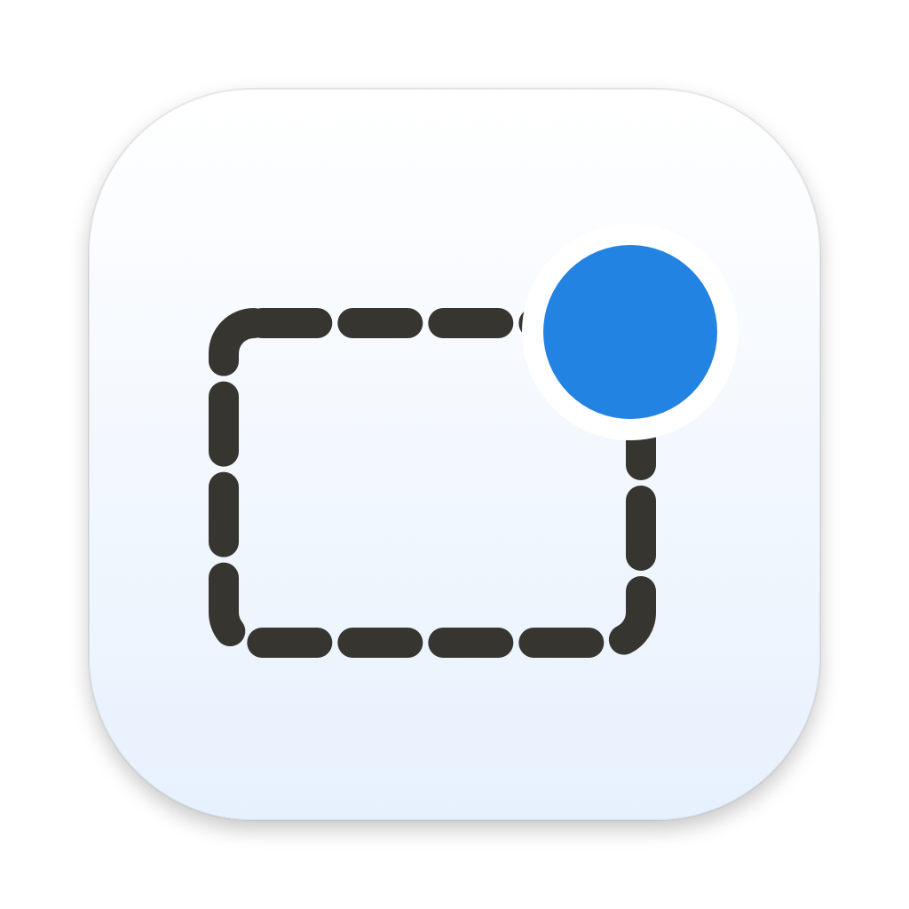
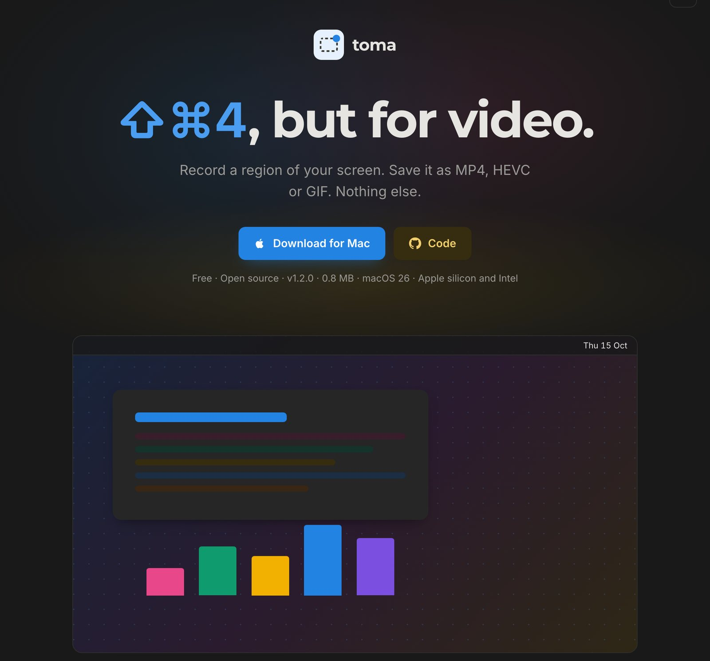
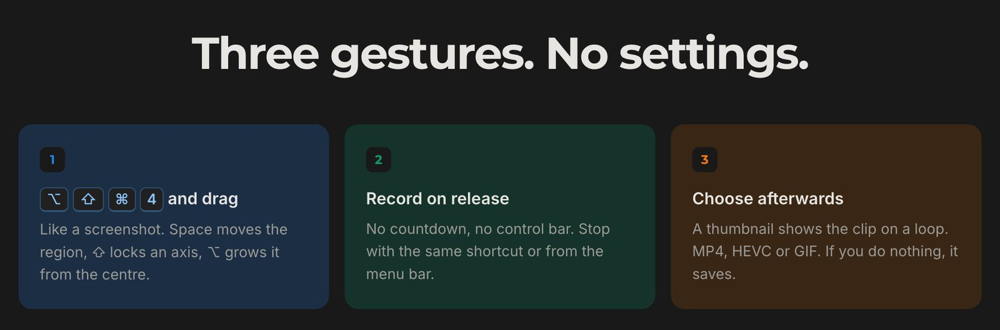
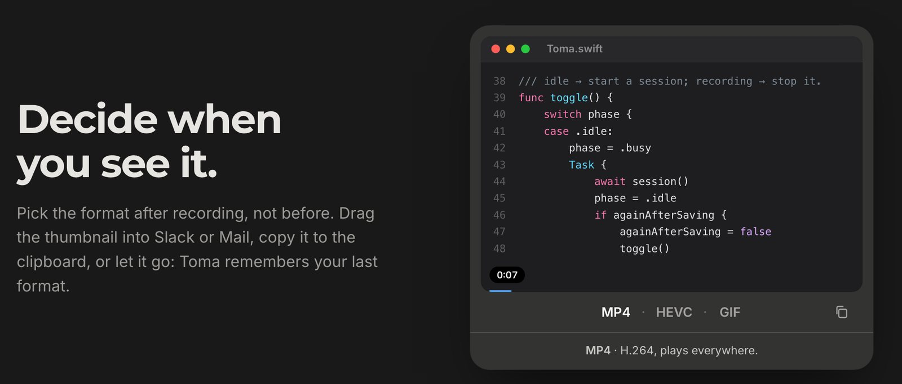
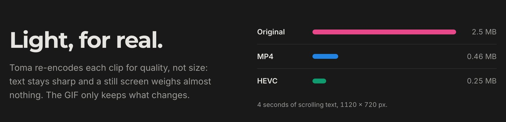

[← Home](../../)

# Toma

Toma is a free, open-source Mac app. It lives in the menu bar: you press a shortcut, drag a rectangle, and it records. When you stop, it saves the clip as MP4, HEVC or GIF.

The name is the point. It works like ⇧⌘4, the Mac's screenshot shortcut, but for video. There is no settings window, no account, and no editor. It records a region of the screen and saves it well.

Everything happens on the Mac. Toma does not connect to the internet, has no analytics, and does not store anything outside the folder you choose.

## How it works

- Press ⌥⇧⌘4 and drag a region. Recording starts as soon as you let go.
- Press the shortcut again, or click the timer in the menu bar, to stop.
- A thumbnail appears in the corner. Pick MP4, HEVC or GIF, copy the file to paste it into Slack or Mail, or drag it into any folder.
- If you do nothing, it saves in the last format you used after six seconds.

## Formats

- **MP4** (H.264) plays everywhere.
- **HEVC** is about half the size and works well on Apple devices and modern browsers.
- **GIF** plays without a player, which suits READMEs and chats.

Toma records a high-quality original first and re-encodes it when you choose a format. Text stays sharp, and a still screen barely adds to the file size.

## How it's built

About 2,500 lines of Swift in a single module, built on ScreenCaptureKit. The state is a small state machine, and each file owns one concern: coordinates, recording and permissions, the library and re-encoding, the GIF encoder, and the interface.

The GIF encoder is custom. Each frame only stores what changed, so interface colours stay exact and gradients stay smooth. The reasoning behind each decision is written up in the repository's architecture notes.

Toma targets macOS 26 or later, runs on Apple silicon and Intel, and weighs under 1 MB. It is signed and notarized, so it opens without warnings, and it has no dependencies.

## Links

- [Toma website](https://toma.felipebasurto.com/en/)
- [Source and release downloads on GitHub](https://github.com/felipebasurto/toma)
